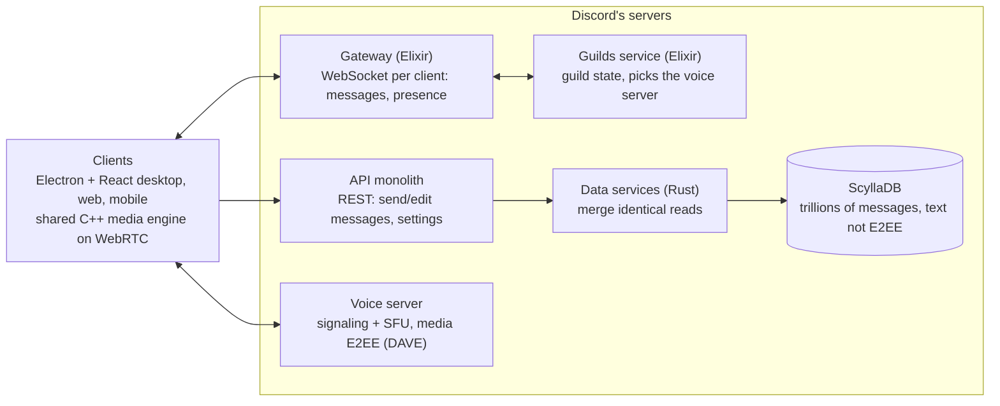

# How Discord works

Discord is a classic client–server system: every message, voice packet and video frame passes through Discord's own machines. The right-hand column reflects the hybrid design chosen in D1: a small backend for text, peer-to-peer for calls.

Data model worth copying: a guild (called a "server" in the app) holds channels (text, voice, categories); roles carry permission bitfields with per-channel overrides; DMs and group DMs sit outside guilds. IDs are "snowflakes": 64-bit numbers with a timestamp inside, so they sort by time.

Clients hold a WebSocket to the Gateway, call the API for actions, and send voice and video to an SFU; nothing travels directly between users.

| Layer | What Discord uses | What it means for us |
| --- | --- | --- |
| Clients | Electron + React desktop app, web app, mobile apps. Desktop and mobile share one C++ media engine built on the WebRTC native library ([source](https://discord.com/blog/how-discord-handles-two-and-half-million-concurrent-voice-users-using-webrtc)) | One shared media core across platforms is a good idea to copy |
| Real-time events | Gateway: a permanent WebSocket per client that pushes messages and presence, built on Elixir | Our small backend keeps one WebSocket per client, like a mini Gateway |
| Actions | REST API in front of an API monolith | Handled by the same small backend |
| Message storage | MongoDB (2015) → Cassandra (2017) → ScyllaDB (2022), with Rust "data services" in front ([source](https://bytebytego.com/guides/how-discord-stores-trillions-of-messages/)) | The backend stores only encrypted messages; each device keeps its own readable copy |
| Voice and video | WebRTC. Each guild is assigned a voice server with a signaling part and an SFU (selective forwarding unit) that forwards streams without mixing them; Opus codec for voice ([source](https://discord.com/blog/how-discord-handles-two-and-half-million-concurrent-voice-users-using-webrtc)) | WebRTC and Opus carry over. No SFU needed: calls of up to 6 run as a mesh (D1, D2) |
| Call encryption | DAVE protocol since September 2024: each frame encrypted with a per-sender key via WebRTC encoded transforms, group keys managed with MLS. Calls became E2EE-only from March 1, 2026 ([blog](https://discord.com/blog/meet-dave-e2ee-for-audio-video), [docs](https://docs.discord.com/developers/topics/voice-connections)) | A strong, audited model to copy; the whitepaper and the libdave library are public |
| Text encryption | TLS to Discord only. Text messages are not end-to-end encrypted, so Discord can moderate them ([source](https://discord.com/blog/meet-dave-e2ee-for-audio-video)) | We can do better: E2EE text by default |
| IP privacy | Because all traffic goes through Discord, users never see each other's IP addresses ([source](https://discord.com/blog/how-discord-handles-two-and-half-million-concurrent-voice-users-using-webrtc)) | Exposed during calls, since calls are peer-to-peer. Users can turn on "Hide my IP" to relay their calls (D14) |

## What goes peer-to-peer

With the hybrid design (D1), only calls go peer-to-peer; the small backend covers introductions, message history and notifications. The connection, media and IP rows below apply to calls.

| Job Discord's servers do | Serverless replacement | The catch |
| --- | --- | --- |
| Introduce users to each other | Invite links carrying public keys, found through a DHT or a small rendezvous service | Something reachable must make the first introduction |
| Connect through home routers | ICE: STUN to discover your public address, then direct "hole punching" | Some networks (strict NATs, mobile carrier NAT, office firewalls) block direct links and need a relay (TURN) |
| Store message history | Each device keeps its own copy; peers sync when they are online together | A message sent while you are offline reaches you only when another member who has it comes online |
| Forward voice and video (SFU) | Full mesh: each sender uploads one copy of its stream per listener | Upload bandwidth grows with group size, so video groups must stay small |
| Enforce permissions and bans | Rules signed by admins and checked by every client | A modified client can ignore rules; only who holds the encryption keys is truly enforceable |
| Hide IP addresses | Optional relaying through other peers or a relay | Direct connections reveal your IP to every peer |
| Push notifications on phones | Hard without a server: iOS and Android stop background connections | Mobile is the hardest platform for a serverless app |

Rough bandwidth example (approximate, for scale only): a 720p webcam stream is around 1.5 Mbps. In a 6-person video mesh, each person uploads 5 copies, about 7.5 Mbps, which many home connections cannot sustain.

## Similar projects to study

Keet is the closest existing match to this idea and the first project to study hands-on. The others each solve one piece well. Only Keet was checked against current sources; the rest are from general knowledge and should be verified before relying on details.

| Project | How it works | What to learn from it |
| --- | --- | --- |
| [Keet](https://docs.pears.com/apps/keet) | Fully P2P chat, voice and video on desktop and mobile, built on the Holepunch stack (Hyperswarm). Users are found by public key through distributed hole punching; any peer can relay a signed message to others ([source](https://docs.pears.com/apps/keet)) | Discovery without servers, message relaying, real-world reliability: app reviews mention calls sometimes needing 1–3 tries ([source](https://mwm.ai/s/apps/keet-private-encrypted-chat/6443880549)) |
| Jami | P2P voice, video and chat using a DHT (OpenDHT); group conversations sync between members' devices | Group sync without a server, account = key pair |
| Tox (qTox) | P2P DHT messenger with E2EE text and calls | Simple identity model (one Tox ID); also a warning about slow, volunteer-only development |
| Briar | P2P over Tor, Wi‑Fi or Bluetooth; text only | Strong threat model and metadata protection |
| Mumble | Open-source, very low-latency voice; needs a self-hosted server | Audio pipeline quality (Opus, noise handling, push-to-talk) |
| Matrix / Element | Federated, not P2P; E2EE group chat (Olm/Megolm, moving toward MLS) | Group key management, device verification UX |
| Signal | Central servers, but best-in-class E2EE (Signal Protocol, Sender Keys) | Encryption design and safety-number verification |
