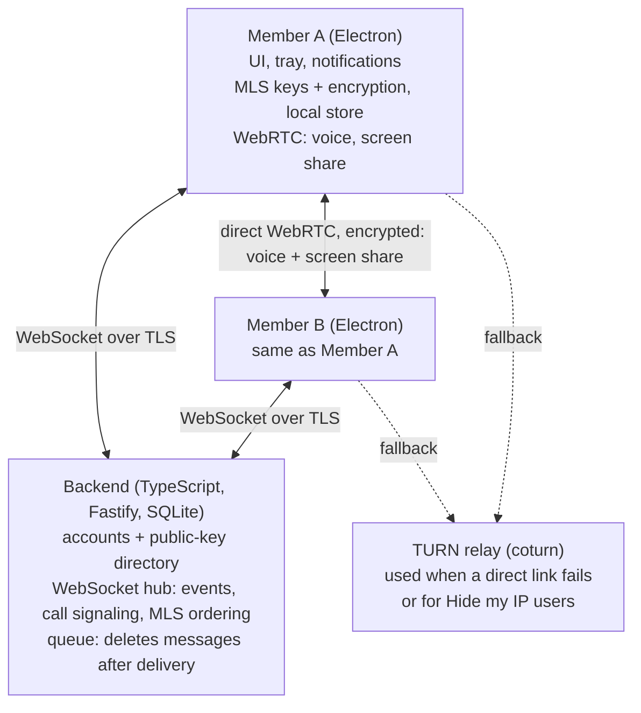

# Architecture

The app has three parts: an Electron client on each member's computer, a small TypeScript backend, and a TURN relay. Text travels through the backend already encrypted; voice and screen sharing travel directly between members.

Up to 10 members per group, up to about 6 in a call.

The backend never holds readable messages or call media; the dashed TURN links are used only when a direct link fails or a member hides their IP.

| Part | What it does | Decisions behind it |
| --- | --- | --- |
| Electron client | Interface and tray app; MLS keys and encryption; local message store; WebRTC voice and screen sharing; notifications, with previews hidden while sharing | D4, D5, D7, D8, D10, D11, D15 |
| Backend (TypeScript) | Accounts and the public-key directory; one WebSocket per client for real-time events; MLS ordering; call signaling; a queue that deletes messages after delivery; the 10-member group limit | D1, D6, D7, D9, D12, D13, D17 |
| TURN relay | Carries call media when a direct link fails, or for members who turn on "Hide my IP"; sees only encrypted media | D1, D14 |

## Sending a message

1. The sender's client encrypts the message with the group's current MLS key and sends it over the WebSocket.
2. The backend checks that the sender is a member and queues the encrypted message for every member's devices.
3. Online devices receive it at once; offline devices fetch it when they reconnect.
4. Each device decrypts and stores it locally, then confirms delivery. Once every device has confirmed, the backend deletes it; undelivered copies expire after 30 days (D24).

## Joining a call

1. A member clicks Join, and the client announces it over the WebSocket.
2. Members' clients exchange connection details (WebRTC offers, answers and network candidates) through the backend; these are encrypted with MLS (D18), so the backend cannot alter them.
3. Each pair of members connects directly. If that fails, the pair connects through the TURN relay; a member with "Hide my IP" on always connects through it.
4. Each member sends Opus voice to every other member. A screen share is encoded once per viewer, with the codec from settings.

## Implementation decisions

- D18 — Protecting calls from a compromised backend: decided, call setup encrypted with MLS
- D19 — Backend database: decided, SQLite
- D20 — Local storage: decided, plain SQLite
- D21 — Interface framework: decided, React
- D22 — MLS library: decided, OpenMLS through WebAssembly
- D23 — TURN server: decided, coturn
- D24 — Undelivered messages: decided, wait up to 30 days
