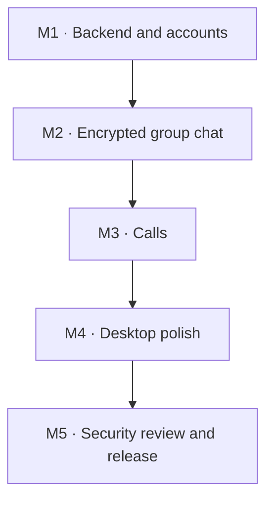

# Milestone plan

Five milestones in foundation-first order (D25), each closed by a test it must pass before the next begins.

| Milestone | Builds | Done when |
| --- | --- | --- |
| M1 · Backend and accounts | Electron + React shell; TypeScript backend with SQLite; sign-up, login, password change and recovery, WebSocket, key directory | Two clients sign up, log in and see each other online |
| M2 · Encrypted group chat | OpenMLS via WebAssembly; groups of up to 10; add by username; new devices; leaving and blocking; queue deleted after delivery | An offline member gets messages later; the server holds only ciphertext; removed members cannot read new messages |
| M3 · Calls | Voice and screen share (VP8, VP9, H.264); mesh of 6; call setup encrypted with MLS; coturn relay; Hide my IP; push-to-talk and mute hotkey | A 6-person call with screen share works on Windows; CPU per viewer measured per codec; a call connects through the relay when Hide my IP forces it (the strict-firewall test through port 443 runs in the server deployment) |
| M4 · Desktop polish | Tray and quit setting; start at login; notifications hidden while sharing; settings screen; safety numbers | Every setting from D11b, D14, D15, D15b, D44 to D44c and D46 behaves as decided |
| M5 · Security review and release | Security checklist; a hardened Windows installer; automatic updates; GitHub Actions releases; server deployment | The security checklist passes; the installer runs and updates on a clean Windows machine |

No dates yet: each milestone ends at its gate, not on a deadline. The codec and screen-sharing tests from D11 now happen in M3, when calls are built.

## Decisions inside the milestones

All are decided; the details are in the Decision log.

- D25 — Milestone order: decided, foundation first
- D26 — Repository layout: decided, one repository
- D27 — Build and packaging: decided, electron-vite with electron-builder
- D28 — Backend libraries: decided, Fastify
- D29, D29b — Signing and updates: decided, no paid signing, unsigned automatic updates, no extra check
- D31 to D33 — pnpm, Vitest, ESLint with Prettier: decided
- D34 to D36 — better-sqlite3, Argon2id, TypeBox: decided
- D37 to D38 — short-lived HS256 JWTs with refresh tokens, and MLS suite 1: decided
